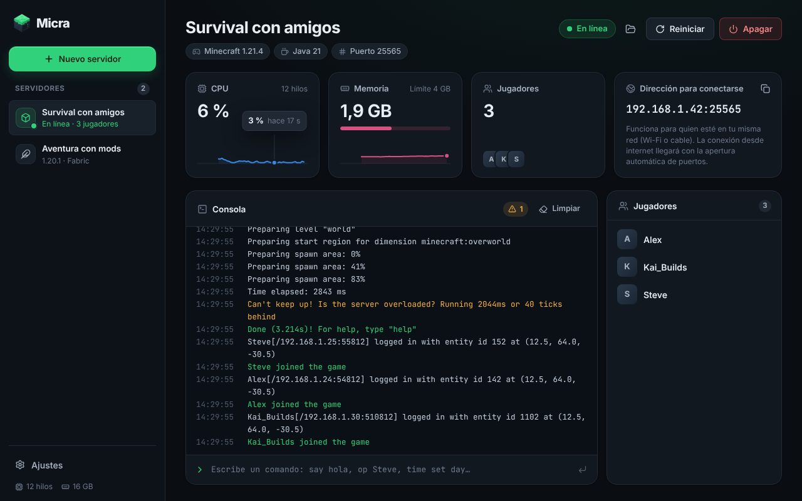

<p align="center"></p>

# Micra

Convierte tu PC (Windows o Linux) en un servidor de Minecraft sin escribir
código ni configurar el router: modpacks de Modrinth y CurseForge, Java
gestionado automáticamente, asistente de RAM/CPU y panel en tiempo real.



## Instalar

No hace falta instalar nada más: ni Java, ni Node, ni Rust. Micra descarga
la versión de Java que necesita cada servidor la primera vez que lo creas.

**Windows**: descarga `Micra_x.y.z_x64-setup.exe` de la página de
[Releases](https://github.com/volo340/Micra/releases) y ábrelo. Se instala
para tu usuario (no pide permisos de administrador) y, si el equipo no tiene
WebView2, lo instala solo.

**Linux**: descarga `micra-install.sh` de la misma página y ejecútalo:

```bash
bash micra-install.sh
```

El script elige el mejor formato para tu distribución:

- Debian, Ubuntu, Mint, Pop!_OS: instala el `.deb` con apt, que añade las
  librerías del sistema que falten.
- Fedora y openSUSE: instala el `.rpm` con dnf o zypper.
- Cualquier otra distribución, o si no tienes sudo: instala el AppImage en tu
  carpeta de usuario y crea el acceso directo en el menú.

Otras opciones: `--appimage` (solo para tu usuario, sin sudo) y `--uninstall`
(desinstala; tus servidores y mundos se conservan).

Mientras el repositorio sea privado, el script no puede descargar nada de
GitHub por su cuenta: descarga los archivos de la release o del artefacto de
Actions y ejecuta `bash micra-install.sh` en esa misma carpeta.

## Desarrollo

Hecho con Tauri 2 + Rust + React/TypeScript. La arquitectura está en
[docs/ARCHITECTURE.md](docs/ARCHITECTURE.md) y el diseño (logo, colores y
reglas de la interfaz) en [docs/DESIGN.md](docs/DESIGN.md).

Requisitos solo para desarrollar: Rust estable, Node 20+ y, en Linux, las
dependencias de Tauri (`libwebkit2gtk-4.1-dev`, `librsvg2-dev`,
`libayatana-appindicator3-dev`).

```bash
npm install
npm run tauri dev           # la app con recarga en caliente
npm run dev                 # solo la interfaz, en el navegador y con datos simulados
cargo test -p micra-core    # tests del núcleo
```

## Publicar una versión

No hace falta compilar en tu PC: GitHub Actions genera los instaladores.

1. Sube la versión en `src-tauri/tauri.conf.json`, `package.json` y
   `Cargo.toml`.
2. Crea y sube la etiqueta: `git tag v0.1.0 && git push origin v0.1.0`.
3. Cuando termine el flujo **Build**, revisa el borrador en
   [Releases](https://github.com/volo340/Micra/releases) y publícalo.

Cada pull request también compila los instaladores; se descargan desde la
ejecución del flujo en la pestaña Actions, en el apartado *Artifacts*.
