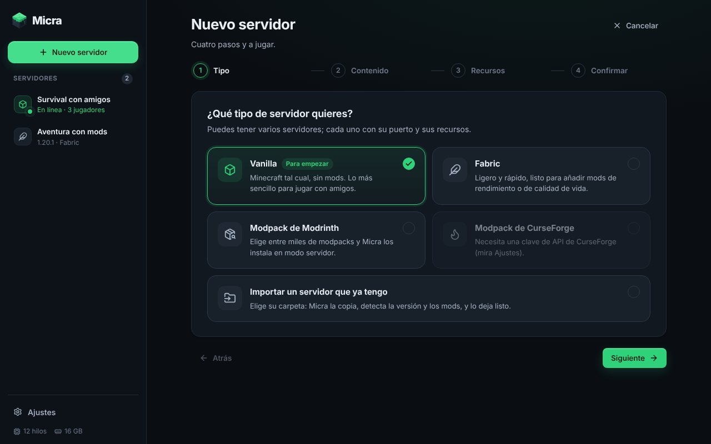

# Diseño de Micra

## Logo

Un bloque de hierba que también es un servidor: la cara de arriba es la hierba
de Minecraft y la cara derecha lleva las ranuras y los LEDs de un rack.

- `app-icon.svg`: el icono de la app, con su fondo redondeado. Los iconos de
  Windows (`.ico`) y Linux se generan a partir de él:
  `npx tauri icon app-icon.svg -o src-tauri/icons`.
- `src/assets/logo.svg`: solo el bloque, para usar dentro de la interfaz.

## Colores

Salen del logo: el verde de la hierba es el color de marca y los grises
pizarra de las caras del bloque son las superficies. Todos están en
`src/styles/tokens.css`; ningún componente escribe colores sueltos.

| Token | Valor | Uso |
|---|---|---|
| `--brand` | `#2fd27a` | Acción principal, foco, servidor en línea |
| `--bg` | `#0a0e13` | Fondo de la ventana |
| `--surface`, `--surface-2`, `--surface-3` | `#121820`, `#18202a`, `#1f2833` | Tarjetas y controles, de menos a más elevados |
| `--text`, `--text-2`, `--text-3` | `#e9eef5`, `#a7b2c2`, `#6e7a8c` | Texto principal, secundario y discreto |
| `--warning` | `#f5b13d` | Avisos de la consola, servidor arrancando |
| `--critical` | `#f0565a` | Errores, servidor detenido por un fallo |
| `--series-cpu` | `#3987e5` | Gráficas de CPU |
| `--series-ram` | `#d55181` | Gráficas de memoria |
| `--series-players` | `#9085e9` | Gráfica de jugadores |
| `--series-tps` | `#199e70` | Gráfica de TPS |

Micra solo tiene tema oscuro.

## Tipografía e iconos

- Inter Variable para el texto y JetBrains Mono Variable para la consola,
  las direcciones y las versiones. Van dentro de la app, así que se ven
  igual sin conexión a internet.
- Iconos de [Lucide](https://lucide.dev).

## Reglas

- Un estado nunca se indica solo con color: siempre lleva un icono, un punto
  o un texto ("En línea", "Iniciando…", "Se detuvo con un error").
- Los cuatro colores de las gráficas se distinguen también con daltonismo
  (deuteranopia, protanopia y tritanopia) y contrastan con las tarjetas. El
  texto nunca usa el color de una gráfica.
- Cada gráfica muestra una sola medida, con su título y un resumen en texto
  ("Media 41 % · Máximo 71 %"). Nunca hay dos escalas en la misma gráfica.
- Las gráficas son líneas finas de 2 px con un área suave debajo; al pasar
  el ratón muestran el valor y cuándo se midió. Los huecos (servidor
  apagado) se dejan en blanco en vez de unir los puntos.
- Los textos de la interfaz salen de `src/i18n/`; ningún componente escribe
  frases sueltas. Las cifras, fechas y tamaños siguen el idioma elegido
  (`src/lib/format.ts`).
- Con "reducir movimiento" activado en el sistema, la app no anima nada.

## Probar la interfaz sin compilar la app

`npm run dev` abre la interfaz en el navegador (http://localhost:1420) con un
backend simulado (`src/dev/mock.ts`), sin Rust ni Tauri:

- `?state=running`: un servidor encendido con jugadores y alguien que
  intenta entrar sin estar en la lista blanca.
- `?state=empty`: la primera vez, sin servidores.
- `?lang=en` (o `pt`, `fr`, `de`): el idioma del sistema simulado.
- `?platform=windows`: los textos y opciones de Windows.
- `?update=1`: hay una versión nueva de Micra.
- `?malware=1`: el análisis de mods encuentra malware.

Se pueden combinar: `http://localhost:1420/?state=running&lang=de&update=1`.

El simulador solo existe en desarrollo; no se incluye en los instaladores.
